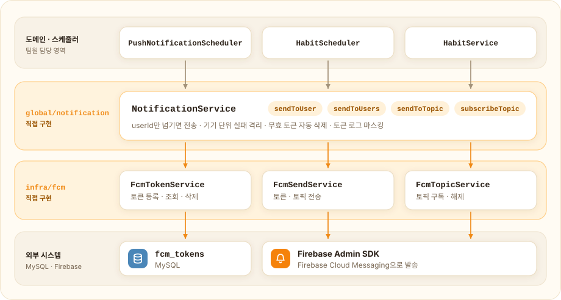
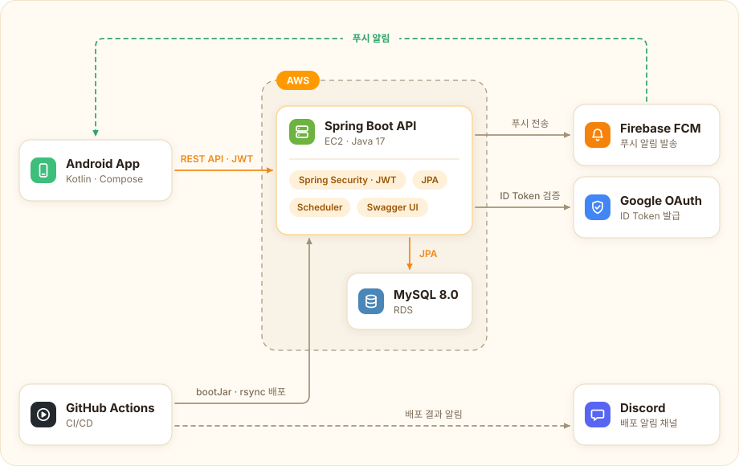

<div align="center">

# 해봄 Server

### 스스로 하는 힘을 만드는 습관 관리 앱 「해봄」의 백엔드


<br><br>


</div>

> [!NOTE]
> 이 저장소는 팀 저장소 [swyp-4th-team7/server](https://github.com/swyp-4th-team7/server)를 포크한 개인 저장소입니다.
> 서버 개발자 3명 중 한 명으로 참여했고, 제가 맡은 부분은 [내가 한 일](#my-work)에 정리했습니다.

> 개발 기간

- 2026.02 ~ 2026.04 (MVP 개발 약 한 달, 2026.04.12 Google Play 출시)

> 팀 구성

- **Server:** 3명 (본인 포함)
- **Android:** 1명 · [android 저장소](https://github.com/swyp-4th-team7/android)
- **Product Design:** 3명
- **Product Manager:** 2명

---

#  서비스 소개 및 시연 영상

「해봄」은 아이가 할 일과 습관을 스스로 계획하고 실천하도록 돕는 앱입니다.
부모와 자녀가 초대 코드로 연결되어 서로의 오늘 할 일과 습관 현황을 확인하고,
하루 할 일을 모두 마치면 스티커를, 습관을 끝까지 지키면 약속한 보상을 받습니다.

https://github.com/user-attachments/assets/47b2d086-a584-4eef-a664-fb0c914c6c32

---

#  주요 기능


---

<a id="my-work"></a>

# 🙋 내가 한 일

서버 PR 55건 중 **15건**을 맡았습니다. 링크는 모두 팀 저장소의 PR입니다.

| 영역 | 내용 | PR |
| --- | --- | --- |
| **푸시 알림 인프라** | Firebase Admin SDK 초기화, FCM 토큰 등록·삭제 API, 토큰·토픽 전송, 무효 토큰 자동 정리 | [#14][pr14] [#24][pr24] |
| **예외 처리** | Security 인증·인가 실패 응답 통일, 검증 오류별 에러 코드, 404·405 처리 | [#27][pr27] [#80][pr80] |
| **가족 연결** | 초대 코드 발급·조회, 사용자 간 연결·해제, 구성원별 할 일·습관 현황 대시보드 | [#50][pr50] [#67][pr67] [#71][pr71] |
| **스티커** | 주간 스티커·스티커판 조회, 주차 이동, 스티커판 완성 확인 | [#48][pr48] [#59][pr59] [#73][pr73] |
| **할 일** | 할 일 CRUD, soft delete와 30일 뒤 영구 삭제 스케줄러, 부모·자녀 역할별 카테고리 | [#36][pr36] [#43][pr43] [#52][pr52] |
| **프로필 온보딩** | 신규 가입자를 미완성 상태로 저장, 닉네임·역할 설정, 로그인 응답에 온보딩 여부 포함 | [#33][pr33] |
| **개발 환경** | Docker Compose 기반 로컬 MySQL, `.env` 환경 변수 구성 | [#9][pr9] |

## 1. 다른 도메인이 Firebase를 몰라도 되는 푸시 알림 모듈

알림 스케줄러와 습관 도메인은 팀원이 담당했기 때문에, 누구든 `userId`만 넘기면 푸시를 보낼 수 있는 공통 모듈이 먼저 필요했습니다.

<picture>
  <source media="(prefers-color-scheme: dark)" srcset="docs/images/notification-dark.svg">
  
</picture>

- **계층 분리:** [`infra/fcm`](src/main/java/com/swyp/server/infra/fcm)은 SDK 호출과 예외 변환만 맡고, [`NotificationService`](src/main/java/com/swyp/server/global/notification/NotificationService.java)가 "이 사용자에게 보내기"라는 도메인 관점의 API를 제공합니다. 도메인 코드는 `NotificationService`만 의존합니다.
- **토큰 upsert:** FCM 토큰은 기기 식별자이므로 unique 컬럼으로 두고, 같은 토큰이 다시 등록되면 소유자만 갱신합니다. 한 기기에서 계정을 바꿔 로그인해도 이전 계정의 알림이 가지 않습니다.
- **무효 토큰 자동 정리:** 전송 실패 사유가 `UNREGISTERED`, `INVALID_ARGUMENT`일 때만 토큰을 삭제합니다. 그 외 오류는 일시적일 수 있어 토큰을 남겨 둡니다.
- **실패 격리:** 기기 단위로 예외를 처리해 한 기기의 실패가 다른 기기나 다른 사용자의 전송을 막지 않고, 푸시 실패가 호출한 비즈니스 로직으로 전파되지 않습니다.
- **로그 마스킹:** 토큰은 앞 8자리와 길이만 로그에 남깁니다.

에러 코드별 토큰 삭제 여부는 [`NotificationServiceTest`](src/test/java/com/swyp/server/global/notification/NotificationServiceTest.java)에서, SDK 초기화 분기는 [`FcmInitializerTest`](src/test/java/com/swyp/server/infra/fcm/FcmInitializerTest.java)에서 단위 테스트로 검증했습니다.

## 2. 어디서 실패해도 같은 모양인 에러 응답

팀 공통 응답 포맷 `{ code, message, data }`를 컨트롤러 밖에서 발생하는 예외까지 확장했습니다. `code`는 HTTP 상태 3자리에 일련번호 2자리를 붙인 값이라, 클라이언트가 코드만 보고 분기할 수 있습니다.

```json
{ "code": 40102, "message": "만료된 토큰입니다.", "data": null }
```

- **Security 필터 단계의 예외:** 필터에서 난 인증·인가 실패는 `@RestControllerAdvice`까지 오지 않습니다. [`SecurityExceptionHandler`](src/main/java/com/swyp/server/global/exception/SecurityExceptionHandler.java)가 `AuthenticationEntryPoint`와 `AccessDeniedHandler`를 함께 구현해 같은 포맷으로 응답합니다.
- **토큰 만료와 위조 구분:** `JwtAuthenticationException`에 `ErrorCode`를 실어, 만료(`40102`)와 유효하지 않은 토큰(`40101`)을 구분해 내려줍니다. 클라이언트는 만료일 때만 재발급을 시도하면 됩니다.
- **검증 오류별 에러 코드:** Bean Validation의 `message`에 `ErrorCode` 이름을 적고, 핸들러에서 enum으로 변환합니다. 필드마다 고유한 코드가 내려갑니다.

  ```java
  @NotBlank(message = "NICKNAME_REQUIRED")
  @Size(min = 1, max = 12, message = "NICKNAME_LENGTH_INVALID")
  String nickname
  ```

- **404·405 처리:** 없는 경로나 지원하지 않는 메서드 요청이 최종 `Exception` 핸들러로 떨어져 500으로 응답되던 것을 전용 핸들러로 분리했습니다.
- **재발급 검증 보강:** 이 작업 중 토큰 재발급이 토큰 검증 없이 `userId`를 꺼내 쓰는 흐름을 발견해 `validateToken()`을 추가했습니다.

## 3. 저장하지 않고 계산하는 스티커

하루의 할 일을 모두 완료하면 스티커 1개, 30개를 모으면 스티커판이 완성됩니다.

- **스티커는 조회 시점에 계산:** 날짜별 스티커를 따로 저장하지 않고, 할 일 완료 상태에서 "모든 할 일을 끝낸 날짜"를 구합니다. 할 일을 나중에 체크 해제하거나 삭제해도 별도의 동기화 로직이 필요 없습니다.
- **저장하는 상태는 정수 하나:** 사용자가 마지막으로 확인한 완료 일수(`lastConfirmedCompletedDateCount`)만 저장합니다.

  ```text
  현재 판 진행도 = 전체 완료 일수 − 확인한 완료 일수
  완성 팝업 노출 = 진행도 ≥ 30
  확인 처리     = 확인한 완료 일수 += (진행도 ÷ 30) × 30
  ```

  30개를 넘긴 나머지는 다음 판으로 이월됩니다.
- **주차 이동:** `weekOffset`(−52 ~ 52)을 받아 서버 시간(Asia/Seoul) 기준으로 월~일 범위를 계산합니다.

관련 코드: [`StickerQueryService`](src/main/java/com/swyp/server/domain/sticker/service/StickerQueryService.java), [`StickerService`](src/main/java/com/swyp/server/domain/sticker/service/StickerService.java)

## 4. 초대 코드 기반 가족 연결과 대시보드

- **초대 코드:** 온보딩을 마치면 `SecureRandom`으로 8자리(A–Z, 0–9) 코드를 발급합니다. unique 제약을 걸고, 충돌하면 최대 5회 재시도합니다.
- **양방향 저장:** 그룹 엔티티 없이 사용자 간 직접 연결로 설계하고, 연결 한 건을 `(나 → 상대)`, `(상대 → 나)` 두 행으로 저장합니다. "나와 연결된 사람"을 한쪽 컬럼 조건만으로 조회할 수 있습니다.
- **구성원 수와 무관한 쿼리 횟수:** 대시보드는 연결 관계, 오늘의 할 일, 습관 상태를 `IN` 조건으로 한 번씩 조회한 뒤 메모리에서 구성원별로 묶습니다. 구성원이 늘어도 쿼리는 4번입니다.
- **습관 완료 기준:** 습관이 1개 이상 있고 모두 완료했을 때만 완료로 표시합니다.

관련 코드: [`FamilyRelationService`](src/main/java/com/swyp/server/domain/family/service/FamilyRelationService.java), [`FamilyRelationQueryService`](src/main/java/com/swyp/server/domain/family/service/FamilyRelationQueryService.java)

---

# 🏛️ Architecture

<picture>
  <source media="(prefers-color-scheme: dark)" srcset="docs/images/architecture-dark.svg">
  
</picture>

도메인별로 패키지를 나누고, 각 도메인 안에서 `controller / service / repository / entity / dto`로 계층을 분리했습니다.

```text
com.swyp.server
├── domain
│   ├── auth          # Google 로그인, 토큰 재발급
│   ├── user          # 프로필 온보딩, 초대 코드, 회원 탈퇴
│   ├── family        # 초대 코드 연결, 가족 대시보드
│   ├── todo          # 할 일, 역할별 카테고리
│   ├── habit         # 습관, 보상
│   ├── schedule      # 다가오는 일정
│   ├── sticker       # 주간 스티커, 스티커판
│   └── growth        # 성장 탭
├── global
│   ├── config        # Security, JWT, Swagger
│   ├── exception     # ErrorCode, 전역 예외 처리
│   ├── notification  # 푸시 알림 서비스, 알림 스케줄러
│   ├── response      # 공통 응답 포맷
│   └── util
└── infra
    └── fcm           # Firebase Admin SDK 연동
```

---

# 🛠️ Tech Stack

| 카테고리 | 기술/라이브러리 |
| --- | --- |
| Language | Java 17 |
| Framework | Spring Boot 3.5 (Web MVC, Validation) |
| Persistence | Spring Data JPA, MySQL 8.0 |
| Auth | Spring Security, Google ID Token 검증, JWT (jjwt) |
| Push | Firebase Admin SDK (FCM) |
| API Docs | springdoc-openapi (Swagger UI) |
| Test | JUnit 5, Mockito |
| Infra | AWS EC2, RDS |
| CI/CD | GitHub Actions, Discord 배포 알림 |
| Code Style | Spotless (google-java-format, AOSP) |
| Local | Docker Compose |

---

# 👥 서버 팀 역할

| 담당 | 영역 |
| --- | --- |
| **[SeHyeonCho](https://github.com/SeHyeonCho) (본인)** | 푸시 알림 인프라, 예외 처리, 프로필 온보딩, 할 일, 스티커, 가족 연결·대시보드, 로컬 개발 환경 |
| [yunmi-dev](https://github.com/yunmi-dev) | 프로젝트 초기 세팅, Google 로그인·JWT, AWS 배포·CI/CD, 회원 탈퇴·약관, 일정, 알림 스케줄러, 자녀 스티커 현황, 성장 탭 |
| [guzzang](https://github.com/guzzang) | 습관·보상, 습관 스케줄러, 습관 재도전 |

---

# 🚀 로컬 실행 방법

### 1. 사전 준비

- Docker Desktop 실행
- `.env.example`을 참고해 루트 디렉토리에 `.env` 파일 생성
- Firebase 서비스 계정 키(JSON)를 준비하고 경로를 `FIREBASE_SERVICE_ACCOUNT_PATH`에 지정 (없으면 서버가 시작되지 않습니다)

### 2. 인프라 실행

```bash
docker compose up -d
```

### 3. Spring Boot 실행

```bash
./gradlew bootRun
```

또는 IDE에서 `ServerApplication`을 실행합니다.

### 4. API 문서 확인

서버 실행 후 http://localhost:8080/swagger-ui.html 에서 확인할 수 있습니다.

---

# 📃 Convention

- **브랜치:** Git Flow. `feat/#이슈번호-설명` 브랜치에서 작업해 `develop`으로 PR
- **커밋·PR 제목:** `[Type/#이슈번호] 내용` (예: `[Feat/#17] FCM 푸시 알림 전송 기능 구현`)
- **코드 스타일:** PR 전 `./gradlew spotlessApply` 실행

[pr9]: https://github.com/swyp-4th-team7/server/pull/9
[pr14]: https://github.com/swyp-4th-team7/server/pull/14
[pr24]: https://github.com/swyp-4th-team7/server/pull/24
[pr27]: https://github.com/swyp-4th-team7/server/pull/27
[pr33]: https://github.com/swyp-4th-team7/server/pull/33
[pr36]: https://github.com/swyp-4th-team7/server/pull/36
[pr43]: https://github.com/swyp-4th-team7/server/pull/43
[pr48]: https://github.com/swyp-4th-team7/server/pull/48
[pr50]: https://github.com/swyp-4th-team7/server/pull/50
[pr52]: https://github.com/swyp-4th-team7/server/pull/52
[pr59]: https://github.com/swyp-4th-team7/server/pull/59
[pr67]: https://github.com/swyp-4th-team7/server/pull/67
[pr71]: https://github.com/swyp-4th-team7/server/pull/71
[pr73]: https://github.com/swyp-4th-team7/server/pull/73
[pr80]: https://github.com/swyp-4th-team7/server/pull/80
